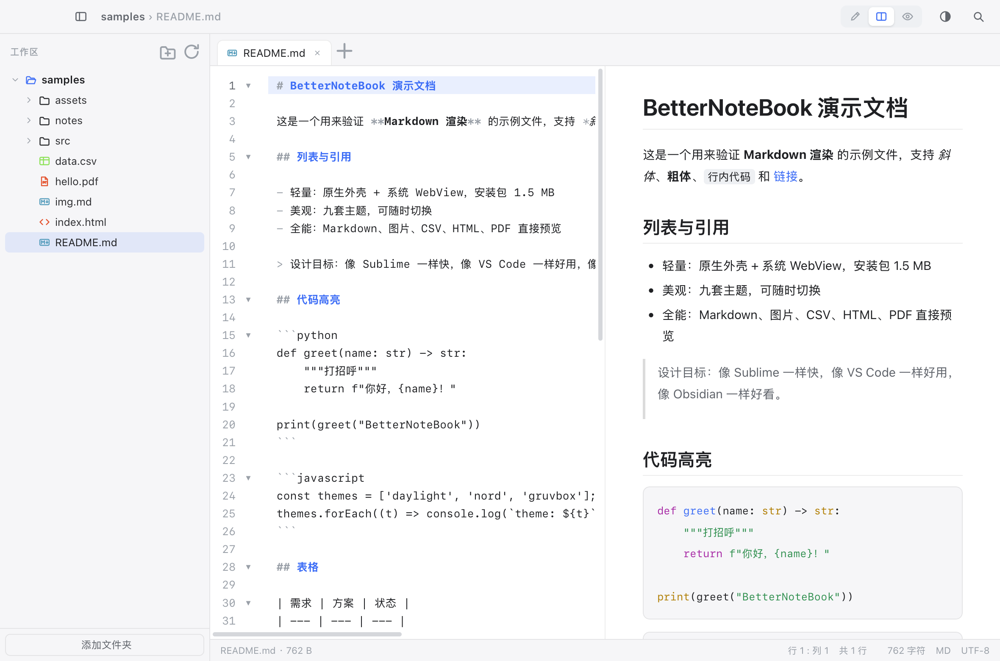

# SuperWorkStation

> 文件 / 笔记 / 终端 / 远程仓库，一个窗口全搞定。
> *Documents, notes, terminal and remote repos — all in one window.*

原生 Swift 外壳 + 系统 WebView，约 **3 MB**，启动即开：左侧导航栏分成「本地」「远程」两个 tab，各自管自己的树，右边是编辑器、预览、终端。

A ~3 MB native shell (Swift + system WebView) that boots instantly: the sidebar has two tabs, Local and Remote, each with its own tree; the right side is editor, preview and terminal.



---

## 中文

### 能做什么

| 能力 | 说明 |
| --- | --- |
| **文档** | Markdown（GFM、代码高亮、相对图片）、代码（CodeMirror 6，20+ 语言）、图片、CSV/TSV、HTML、PDF、EPUB、Office（走系统 Quick Look）、音视频 |
| **编辑** | 编辑 / 对比 / 预览三态切换；按文件保留撤销历史；停止输入自动保存；JSON / sh / py / js 语法检查标红 |
| **文件管理** | 单栏 / 双栏、拖动排序与移动、批量重命名、目录大小统计、Quick Look、压缩包解压 |
| **终端** | 本地 zsh 与 SSH 多标签；会话可保存（分组、颜色、初始目录、密码）；终端内 ⌘F 搜索，回滚 8000 行 |
| **快速命令** | 全局命令库（只存名称 + 内容）：导航栏点「快速命令」增删改，SSH 会话登录后在状态旁边点一下选命令，鼠标或回车即发到当前会话 |
| **远程工作区** | 左侧「远程」tab 里挂 SSH 上的仓库目录，像本地一样展开、编辑、保存；树里显示 `⎇ 分支` 和 M/A/D/?? 改动标记；右键拉取 / 推送 / 提交 |
| **搜索** | ⌘⇧F 同时搜文件名与内容（可区分大小写 / 全词）；⌘P 快速打开；⌘K 命令面板 |
| **AI 助手** | 侧边面板，自动附带当前文档（含 PDF / EPUB 抽取的文本），可整体改写、插入、替换选中 |
| **加密** | 目录或单文件 AES-256-GCM（PBKDF2-SHA256，21 万次）；空闲 15 分钟自动锁定 |
| **文本选择** | 双击选整行、三击选全文；`⌘↑` / `⌘↓` 以整行为单位跳（落点在本行行尾）；预览区双击同样选整行；复制直接进系统剪贴板 |
| **外观** | 101 套深浅配色（VS Code 主流 + Nord / Dracula / Catppuccin / Tokyo Night / Solarized …），4 套文件图标配色 |

### 安全设计

- Markdown **不执行内联 HTML**，页面有严格 CSP
- 自定义协议只放行**已授权目录**，笔记内容读不到 `~/.ssh` 之类的位置
- 写操作同样受白名单限制：只有你打开过或通过对话框选过的目录才可写
- SSH 密码存 `~/Library/Application Support/SuperWorkStation/ssh-secrets.json`（0600），不进设置、不进日志
- AI 的 API Key 存在同目录 `ai.key`（0600）

### 要求与安装

- macOS 13+（Apple Silicon 与 Intel 均可，构建脚本默认编译当前架构）
- 下载 **`SuperWorkStation-0.3.1.dmg`** → 拖进「应用程序」
- 校验值（0.3.1）：`77c815bcc9ca0731bc7ac245ac1d5e060713c129f6fbd31bb4b8f50b74ae6d62`
- 每个版本的变更见 [CHANGELOG.md](CHANGELOG.md)，本次发布说明见 [RELEASE-0.3.1.md](RELEASE-0.3.1.md)
- 应用为 ad-hoc 签名，首次打开请**右键 → 打开**；若仍被拦：
  ```bash
  xattr -dr com.apple.quarantine /Applications/SuperWorkStation.app
  ```

### 从源码构建

```bash
npm install
./build.sh                  # 产出 build/SuperWorkStation.app
./make_dmg.sh               # 产出 dist/SuperWorkStation-<version>.dmg
./scripts/e2e/all.sh        # 回归测试：冒烟 / 设置 / 会话 / 侧边栏 tab / 终端搜索 / 快速命令
```

### 常用快捷键

| 快捷键 | 作用 |
| --- | --- |
| `⌘O` / `⌘P` / `⌘K` | 添加文件夹 / 快速打开 / 命令面板 |
| `⌘⇧F` | 全局搜索（文件名 + 内容） |
| `⌘F` | 文档内搜索；终端内搜索 |
| `⌘⇧B` / `⌘⇧T` | 文件管理标签 / 新建本地终端 |
| `⌘⇧A` | AI 助手 |
| `⌥⌘N` | 全局呼出 / 隐藏窗口 |
| `⌘\` | 文件管理：单栏 / 双栏 |
| 双击 / 三击 | 选中整行 / 全文（编辑器与预览一致） |

---

## English

### What it does

| Area | Details |
| --- | --- |
| **Documents** | Markdown (GFM, syntax highlighting, relative images), code (CodeMirror 6, 20+ languages), images, CSV/TSV, HTML, PDF, EPUB, Office via Quick Look, audio/video |
| **Editing** | Edit / split / preview modes, per-file undo history, autosave, inline diagnostics for JSON / sh / py / js |
| **File manager** | Single or dual pane, drag to move, batch rename, folder sizes, Quick Look, archive extraction |
| **Terminal** | Local zsh and SSH tabs; saved sessions (group, colour, start directory, password); in-terminal ⌘F search, 8000-line scrollback |
| **Quick commands** | Global command library (name + content only): add, edit and delete from the sidebar button; inside a connected SSH session click the button next to the status and pick with the mouse or Enter to send it straight to that shell |
| **Remote workspace** | Mount remote git repos over SSH in the sidebar's Remote tab; browse, edit and save in place; branch and M/A/D/?? badges; right-click pull / push / commit |
| **Search** | ⌘⇧F searches file names *and* contents (case-sensitive and whole-word toggles); ⌘P quick open; ⌘K command palette |
| **AI assistant** | Side panel that auto-attaches the current document (including text extracted from PDF/EPUB); rewrite, insert or replace selection |
| **Encryption** | AES-256-GCM for folders or single files (PBKDF2-SHA256, 210k iterations); auto-locks after 15 idle minutes |
| **Text selection** | Double-click selects the whole line, triple-click the document; `⌘↑` / `⌘↓` move by whole lines; the same in the preview, and copy goes straight to the system clipboard |
| **Appearance** | 101 light/dark themes (VS Code favourites plus Nord, Dracula, Catppuccin, Tokyo Night, Solarized …) and 4 file-icon palettes |

### Security notes

- Markdown **never executes inline HTML**; the page runs under a strict CSP
- The custom URL scheme only serves **allow-listed directories**, so note content cannot read `~/.ssh` and friends
- Writes are gated the same way: only folders you opened (or picked in a dialog) are writable
- SSH passwords live in `~/Library/Application Support/SuperWorkStation/ssh-secrets.json` (mode 0600), never in settings or logs
- The AI API key lives in `ai.key` (mode 0600) next to it

### Requirements & install

- macOS 13+ (Apple Silicon and Intel; the build script compiles the host architecture)
- Download **`SuperWorkStation-0.3.1.dmg`**, drag the app into **Applications**
- SHA-256 (0.3.1): `77c815bcc9ca0731bc7ac245ac1d5e060713c129f6fbd31bb4b8f50b74ae6d62`
- See [CHANGELOG.md](CHANGELOG.md) for per-version notes and [RELEASE-0.3.1.md](RELEASE-0.3.1.md) for this release
- The app is ad-hoc signed — on first launch use **right-click → Open**, or clear the quarantine flag:
  ```bash
  xattr -dr com.apple.quarantine /Applications/SuperWorkStation.app
  ```

### Build from source

```bash
npm install
./build.sh                  # → build/SuperWorkStation.app
./make_dmg.sh               # → dist/SuperWorkStation-<version>.dmg
./scripts/e2e/all.sh        # regression checks: smoke, settings, sessions, sidebar tabs, terminal, quick commands
```

### Shortcuts

| Keys | Action |
| --- | --- |
| `⌘O` / `⌘P` / `⌘K` | Add folder / quick open / command palette |
| `⌘⇧F` | Global search (names + contents) |
| `⌘F` | Find in document; find in terminal |
| `⌘⇧B` / `⌘⇧T` | File-manager tab / new local terminal |
| `⌘⇧A` | AI assistant |
| `⌥⌘N` | Show / hide window globally |
| `⌘\` | File manager: single / dual pane |
| Double / triple click | Select the line / the whole document (editor and preview) |

---

## Powered by DeepSeek

SuperWorkStation 的 AI 助手由 **DeepSeek** 驱动（默认 `deepseek-flash`，可在设置里换成任何 OpenAI 兼容接口）；整个应用也是借助 **DeepSeek Harness** 结对开发完成的。

> The AI assistant in SuperWorkStation is powered by **DeepSeek** (defaults to `deepseek-flash`; any OpenAI-compatible endpoint can be configured in Settings). SuperWorkStation itself was built pair-programming with **DeepSeek Harness**.

[](https://www.deepseek.com/)

## License

MIT

## 更新记录

- 每个版本：见 [CHANGELOG.md](CHANGELOG.md)
- 当前版本 0.3.1 的发布说明（安装、升级、已知限制）：见 [RELEASE-0.3.1.md](RELEASE-0.3.1.md)
